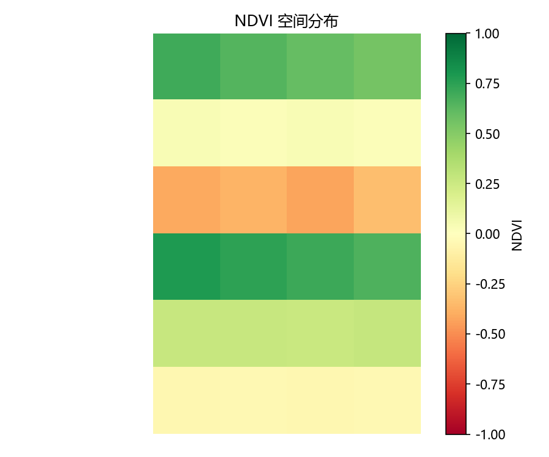

# Week 5 Day 1 详细学习步骤

> 这份是按钮级别的操作指引，照着一步一步做。每步都有"改什么"和"改完看到什么"。

---

## 第 0 步：打开页面看当前效果

三种方式任选：

**方式 A（预览面板）**：右侧预览面板应该已经显示了页面。如果没有，在 WorkBuddy 里点上面卡片里的 `01_first_page.html`。

**方式 B（双击打开）**：在文件管理器里进到 `E:\Dota\projects\geospatial-learning\week05-frontend\`，双击 `01_first_page.html`，会用默认浏览器（Edge）打开。

**方式 C（VS Code 里开）**：用 VS Code 打开 `geospatial-learning` 文件夹，左侧文件树点 `week05-frontend/01_first_page.html`，然后右键选 "Open with Live Server"（如果装了 Live Server 插件）或按 `Ctrl+Shift+V` 预览。

**你现在应该看到的**：一个纯白底页面，顶部大标题"GIS 学习记录"，下面四段导航链接，再往下是四周的内容，每段有一张图片，最底部有一条线和仓库链接。没有颜色、没有排版，就是黑白文字+图片。

---

## 第 1 步：用 VS Code 打开文件

1. VS Code 里按 `Ctrl+O`
2. 选 `E:\Dota\projects\geospatial-learning\week05-frontend\01_first_page.html`
3. 现在你能看到 HTML 源码，左边是代码右边（预览面板）是页面

**对照看**：源码里的 `<h1>GIS 学习记录</h1>` 对应页面上最大的那行标题。源码里的每个 `<section>` 对应页面上一个"周"区块。

---

## 第 2 步：改标题文字（热身）

**操作**：
1. 在 VS Code 里找到 `<h1>GIS 学习记录</h1>`（大约第 11 行）
2. 把"GIS 学习记录"改成"我的 GIS 学习之路"
3. 保存（`Ctrl+S`）
4. 刷新浏览器（`F5` 或 `Ctrl+R`）

**改完看到**：顶部大标题变成"我的 GIS 学习之路"。

**理解**：`<h1>` 是一级标题标签，标签里的文字就是页面上显示的标题。改标签里的文字 = 改页面显示。

---

## 第 3 步：改副标题里的专业信息

**操作**：
1. 找到 `<p>合肥工业大学（宣城校区）· 地球信息科学与技术 · 2025 级</p>`
2. 在后面加一句：改成 `合肥工业大学（宣城校区）· 地球信息科学与技术 · 2025 级 · 大二上学期`
3. 保存 → 刷新

**改完看到**：副标题多了"大二上学期"。

---

## 第 4 步：加一个新 section（核心练习）

在 Week 4 的 section 后面（`</section>` 之后、`</main>` 之前），加一个"Week 5"区块：

**操作**：复制下面这段，粘贴到 Week 4 section 的 `</section>` 后面：

```html
    <!-- Week 5 -->
    <section id="week05">
        <h2>Week 5 — 前端 HTML/CSS</h2>
        <p>学前端三件套的第一件：HTML。用标签描述页面结构，
        做了一个 GIS 学习记录页面（就是你正在看的这个）。</p>

        <h3>本周成果</h3>
        <ul>
            <li>01：HTML 基础 — 文档结构、常用标签、语义化标签</li>
            <li>02：CSS 基础（待做）</li>
            <li>03：布局 flexbox/grid（待做）</li>
            <li>04：作品集页面（待做）</li>
        </ul>
    </section>
```

保存 → 刷新。

**改完看到**：页面底部多了一段"Week 5 — 前端 HTML/CSS"的内容。

**理解**：`<section>` 是一个内容区块，`id="week05"` 让导航能跳到这里（下一步加导航链接）。

---

## 第 5 步：给导航加 Week 5 链接

**操作**：找到导航的 `<ul>`，在 Week 4 那行后面加一行：

```html
            <li><a href="#week05">Week 5 前端</a></li>
```

完整的导航变成：
```html
        <ul>
            <li><a href="#week01">Week 1 基础</a></li>
            <li><a href="#week02">Week 2 pandas</a></li>
            <li><a href="#week03">Week 3 GeoPandas</a></li>
            <li><a href="#week04">Week 4 rasterio</a></li>
            <li><a href="#week05">Week 5 前端</a></li>
        </ul>
```

保存 → 刷新。

**改完看到**：导航多了"Week 5 前端"链接，点它页面跳到 Week 5 区块。

**理解**：`<a href="#week05">` 的 `#week05` 是锚点——`#` 加 section 的 id，点链接就跳到那个 section。

---

## 第 6 步：改图片大小

**操作**：找到任意一张 `` 标签，比如：
```html

```
把 `width="400"` 改成 `width="600"`。

保存 → 刷新。

**改完看到**：那张图变大了。

**理解**：`width` 属性控制图片显示宽度（像素）。不写 height，浏览器会按比例自动算高度。

---

## 第 7 步：理解图片路径（重点）

图片为什么能显示？看 `src="../week01-basics/ndvi_map.png"`：
- `../` 表示"上一级目录"——从 `week05-frontend/` 跳到仓库根目录
- `week01-basics/` 进到 week01 目录
- `ndvi_map.png` 是文件名

**验证你理解了**：如果要在 Week 5 section 里加一张 Week 3 的综合图，src 应该写什么？
答案：`../week03-geopandas/composite_map.png`

---

## 第 8 步：加一段"学习心得"

在 footer 前面（`</main>` 之后、`<footer>` 之前），加一段：

```html
<!-- 学习心得 -->
<section id="notes">
    <h2>学习心得</h2>
    <p>从 2026 年 9 月 22 日开始，从零学 Python 和 GIS。
    5 周时间从"连 git add 都没听过"到能独立跑通 NDVI 分区统计完整流程。</p>
    <p>最大的收获：不是学会了多少 API，而是建立了"写代码 → 跑 → 看结果 → 改"的循环。
    每天一个小练习，积累起来就是仓库里 33 个脚本。</p>
</section>
```

保存 → 刷新。

**改完看到**：页面底部多了"学习心得"段。

---

## 第 9 步：用浏览器"检查元素"（开发者工具）

1. 在浏览器里对着页面上任意文字**右键 → 检查**（或按 `F12`）
2. 浏览器底部/右侧会打开开发者工具
3. 左边是 HTML 源码，右边是样式（现在是空的，Day 2 加 CSS 后会有东西）
4. 鼠标移到左边某个 `<h1>` 上，页面上对应的标题会高亮
5. 双击左边某个标签的文字，可以直接在浏览器里改（不会保存到文件，刷新就没了）

**理解**：开发者工具是前端最重要的调试工具。改代码在 VS Code 里改，但"找问题"用开发者工具。

---

## 第 10 步：提交

```bash
cd /e/Dota/projects/geospatial-learning
git add .
git commit -m "feat: week05 day1 练习（HTML 基础 + 加 Week5 section + 学习心得）"
git push
```

---

## 验收清单

做完上面 10 步，你应该：
- [ ] 能用 3 种方式打开 HTML 文件看效果
- [ ] 改过标题文字、加过 section、加过导航链接、改过图片大小
- [ ] 理解 `<h1>` `<p>` `<section>` `` `<a>` `<ul><li>` 这 6 个标签分别干什么
- [ ] 理解 `src="../xxx/yyy.png"` 相对路径怎么写
- [ ] 知道怎么用浏览器 F12 开发者工具检查元素
- [ ] 页面上有 6 个 section（Week 1-5 + 学习心得）

## 不用全做完

10 步不用全做完。核心是**第 2、4、5 步**（改标题、加 section、加导航链接）——做完这三步你就理解了 HTML 的基本玩法。其他步骤是锦上添花，有时间就做，没时间看一遍理解概念就行。
